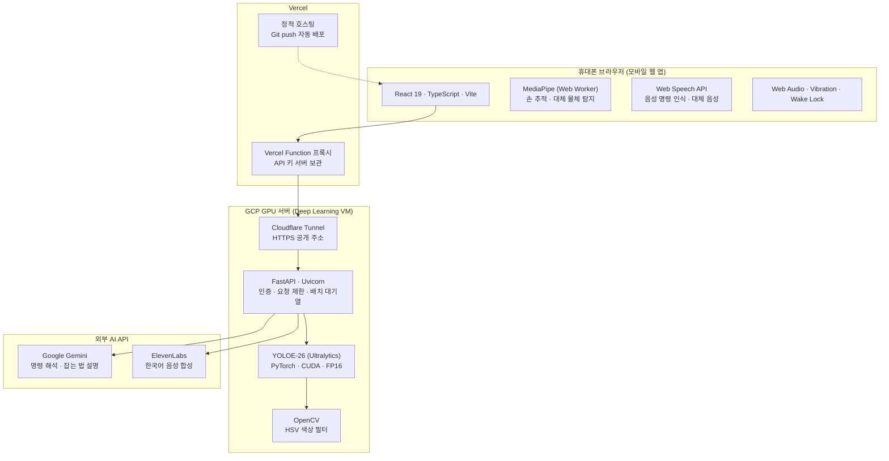
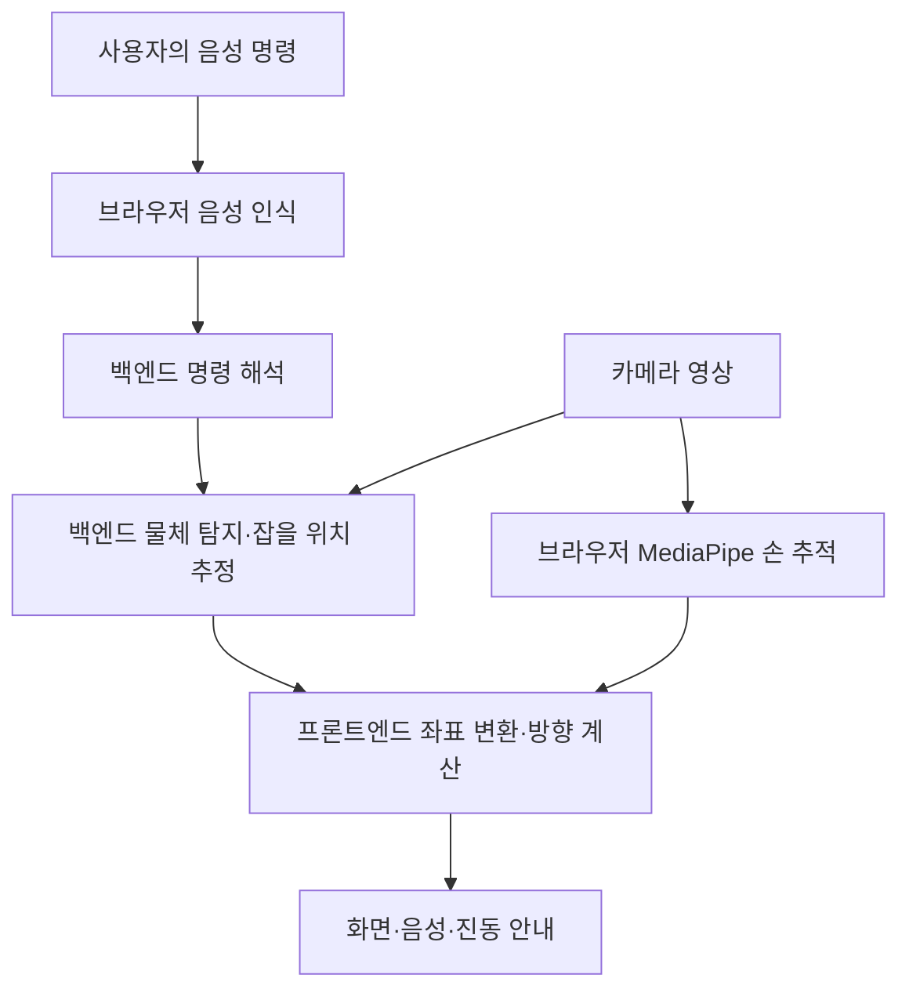

# 손길

### 물건 찾기부터 손 안내까지

**손길은 찾고 싶은 물건을 말하면, 스마트폰 카메라로 물건을 찾고 손을 뻗을 방향까지 안내하는 모바일 웹 서비스입니다.**

시각장애인과 저시력 사용자의 일상 속 물건 찾기를 돕기 위해 만들었습니다. “컵 찾아줘”라고 말하면 물건의 위치를 찾고, 손과 물건의 상대적인 위치를 바탕으로 화면·음성·진동 안내를 제공합니다.

> 이 저장소는 손길의 프론트엔드입니다. 물체 탐지, 명령 해석, 잡는 방법 설명, 음성 생성은 별도의 백엔드 API와 연동합니다.

## 기획 의도

물건이 어디에 있는지 알아도, 손을 어느 방향으로 움직여야 하는지와 어느 부분을 잡아야 하는지는 별개의 문제입니다. 손길은 **물건을 찾는 순간부터 손을 가까이 가져가는 과정까지** 이어서 돕는 데 초점을 맞췄습니다.

별도 장비나 앱 설치 없이 스마트폰 브라우저에서 사용할 수 있도록 구현했고, 화면을 계속 확인하기 어려운 상황을 고려해 짧은 음성 안내와 진동을 함께 사용했습니다.

## 실제 실행 화면

컵을 찾고 손을 안내하는 과정과 가위의 손잡이 확인·주의 안내를 담았습니다.

### 1. 화면을 누르고, 찾을 물건 말하기

<table>
  <tr>
    <th width="33%">시작</th>
    <th width="33%">카메라 준비</th>
    <th width="33%">음성 입력</th>
  </tr>
  <tr>
    <td align="center"></td>
    <td align="center"></td>
    <td align="center"></td>
  </tr>
  <tr>
    <td>화면 어디든 누르면 시작합니다.</td>
    <td>말하기 버튼으로 탐색을 준비합니다.</td>
    <td>“컵 찾아줘”처럼 찾을 물건을 말합니다.</td>
  </tr>
</table>

### 2. 물건을 찾고, 손을 뻗을 방향 안내받기

<table>
  <tr>
    <th width="33%">손잡이 위치 표시</th>
    <th width="33%">손 이동 안내</th>
    <th width="33%">목표 위치 정렬</th>
  </tr>
  <tr>
    <td align="center"></td>
    <td align="center"></td>
    <td align="center"></td>
  </tr>
  <tr>
    <td>컵과 잡을 위치를 표시합니다.</td>
    <td>손의 위치에 따라 이동 방향을 알려줍니다.</td>
    <td>화면상 위치가 맞으면 마지막 안내를 제공합니다.</td>
  </tr>
</table>

### 3. 날카로운 물건은 손잡이 확인과 주의 안내

<table>
  <tr>
    <th width="33%">손잡이 확인 대기</th>
    <th width="33%">잡을 위치 표시</th>
    <th width="33%">주의 안내</th>
  </tr>
  <tr>
    <td align="center"></td>
    <td align="center"></td>
    <td align="center"></td>
  </tr>
  <tr>
    <td>손잡이를 확인할 때까지 손 이동을 기다립니다.</td>
    <td>확인한 잡을 위치를 화면에 표시합니다.</td>
    <td>붉은 안내 패널과 음성으로 주의를 전달합니다.</td>
  </tr>
</table>

## 주요 기능

| 기능 | 구현 내용 |
| --- | --- |
| 음성으로 물건 찾기 | 말하기 버튼을 누르고 물건 이름을 말하면 명령을 해석해 탐색을 시작합니다. |
| 물체 탐지와 추적 | 백엔드 YOLOE 탐지 결과로 목표 물체를 추적하고, 서버 탐지 실패 시 기기 내 EfficientDet Lite0로 대체합니다. |
| 단계별 이동 안내 | **찾기 → 맞추기 → 손 뻗기** 순서로, 휴대폰을 움직일 때와 손을 움직일 때를 구분해 안내합니다. |
| 손과 잡을 위치 연결 | MediaPipe로 손을 추적하고, 백엔드가 추정한 잡을 위치를 기준으로 이동 방향을 계산합니다. |
| 음성·화면·진동 피드백 | 짧은 안내 문장, 큰 글씨와 방향 아이콘, 상태별 색상과 진동을 함께 제공합니다. |
| 위험 상황 안내 | 날카로운 물건은 손잡이를 먼저 확인하고, 손이 추정 칼날 구역에 들어오면 경고합니다. |
| 탐색 중지 | 탐색 중에는 버튼이 ‘그만’으로 바뀌며, 누르면 안내와 진행 중인 요청을 중지합니다. |

## 사용 방법

1. 스마트폰 브라우저에서 서비스를 열고 **시작**을 누릅니다. 카메라·마이크 권한을 허용합니다.
2. **말하기** 버튼을 누른 뒤 “컵 찾아줘”처럼 찾을 물건을 말합니다.
3. 휴대폰 방향 안내에 따라 주변을 천천히 비춥니다.
4. 물건을 찾으면 휴대폰을 유지한 채 손을 카메라에 보이게 합니다.
5. “오른쪽으로”, “몸 쪽으로” 같은 안내에 따라 손을 움직입니다.
6. 손과 목표 위치가 화면상 정렬되면 마지막 안내 후 탐색을 종료합니다. 중간에 멈추려면 **그만** 버튼을 누릅니다.

**시연 포인트:** 컵으로 음성 입력부터 손 안내까지 확인한 뒤, 가위 인식 시 손잡이를 먼저 확인하는 흐름과 주의 안내를 확인할 수 있습니다.

## 구현에서 신경 쓴 점

- **조작을 단순하게 구성했습니다.** 시작 화면 전체를 누를 수 있게 하고, 카메라 화면에서는 하나의 큰 버튼으로 말하기와 중지를 처리합니다.
- **현재 해야 할 행동을 짧게 전달합니다.** 휴대폰 방향 맞추기와 손 이동을 단계로 나누고, 재생 중인 음성에 맞춰 화면 안내를 유지합니다.
- **인식이 잠깐 끊겨도 안내가 흔들리지 않도록 했습니다.** 목표 물체를 고정해 추적하고, 물건을 놓치면 다시 찾을 방향을 안내합니다.
- **서버와 브라우저의 역할을 나눴습니다.** 물체 탐지와 설명은 백엔드가, 손 추적과 방향 계산은 브라우저가 담당합니다. 손 추적은 Web Worker에서 실행합니다.

## 기술 스택 및 구조

| 구분 | 기술 | 역할 |
| --- | --- | --- |
| 프론트엔드 | React 19, TypeScript 5.9 | 화면 구성, 상태 관리, 안내 로직 |
| 개발·빌드 | Vite 7 | 개발 서버, HTTPS 개발 모드, 프로덕션 빌드 |
| 손 추적·로컬 탐지 | MediaPipe Tasks Vision, Web Worker, WASM | 손 관절 추적, 서버 탐지 실패 시 로컬 물체 탐지 |
| 음성·피드백 | Web Speech API, Web Audio API, Vibration API | 음성 입력, 안내 음성·효과음 재생, 진동 |
| 백엔드 연동 | Fetch API, YOLOE 및 명령·설명·TTS API | 물체 탐지, 명령 해석, 잡을 위치와 주의사항 추정 |
| 배포 구성 | Vercel | 정적 파일 제공, `/api` 요청 중계 |

탐지·설명을 위해 캡처한 이미지는 백엔드로 전송합니다. 손 추적은 브라우저 내부에서 처리하며, 안내 음성은 **고정 녹음 → 서버 TTS → 브라우저 TTS** 순으로 대체할 수 있도록 구성했습니다.
